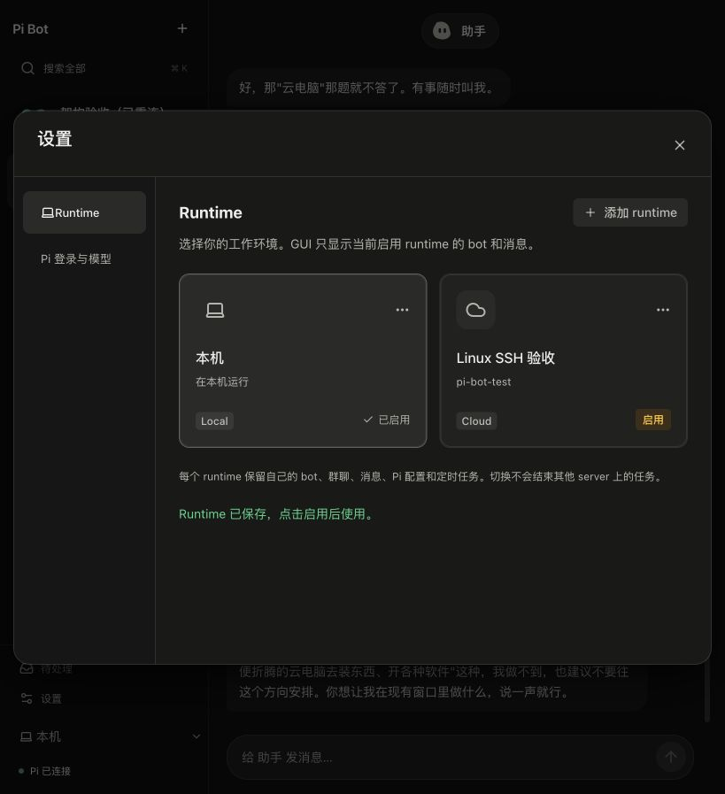
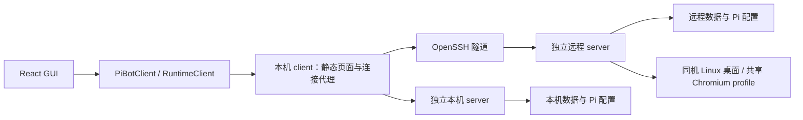
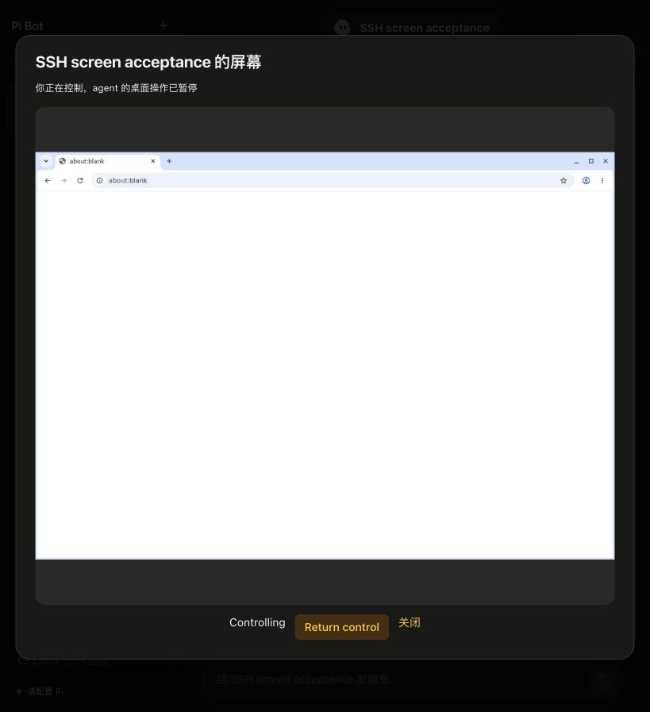

# Runtime 连接、设置与头像

2026-10-14。接续 [app-server 实现](app-server-implementation-20261014.md)。此文取代早期“GUI 与 daemon 同进程”和“仅固定 Local/SSH 两项”的启动方式。Pi 执行、inbox、send_message、后台压缩和 bot 所有的 schedule/monitor 仍由 server 管理。

## 用户流程

设置有 Runtime、Pi 模型两个分类。模型使用为主页面，认证由「管理认证」进入二级页面，见 [模型设置改进](../pi-settings-ui-20261014.md)。Runtime 用命名卡片表示工作环境，卡片显示名称、主机、启用状态和管理菜单。主页面保留一个会话列表和 Cmd+K 搜索。

1. 点「添加 runtime」，选择本机或 SSH，输入名称；SSH 还需要主机或 SSH 配置别名。
2. 「添加 runtime」只保存连接配置，不启动 server、不切换当前聊天、不尝试登录。目录、端口、Node 路径和 SSH 配置文件放在高级设置。
3. 点卡片「启用」，客户端启动或复用对应 server，成功后切换会话。连接失败保留原 runtime 和消息，错误显示在连接操作附近，不盖住整页。
4. 管理菜单支持编辑、重新连接、移除连接。当前启用项需先切换才能移除；至少保留一个。移除不会删除 server 数据，也不会停止它的任务。
5. 配置多个 runtime 时侧栏提供切换菜单，卡片/菜单显示 Local 或 Cloud；只有一个时不显示该标识。

切换后的 GUI 只读该 runtime 的 bot、群聊、消息、任务、桌面、Pi 配置。已有 server 继续运行。两个 runtime 不同步数据，bot 不跨 server 互聊。群聊仍是 server 内的共享消息；@ 是优先级和指向提示。



## 进程与 SDK 边界



- `client` 不创建 BotRuntime 或 SQLite；它管理连接配置、静态页面、浏览器会话及 HTTP/SSE/WebSocket 代理。
- `daemon` 是 runtime、SQLite 和模型会话的宿主。SDK 的 bot/group/thread/turn/request/routine/desktop 方法保持原形状。
- RuntimeClient 提供 `runtime.status/configure/connect/remove/disconnect`，仅用于客户端连接设置，不进入模型工具。
- 配置最多 32 个命名 runtime，保存为 `profiles[] + selectedId`，文件权限 0600、原子替换。旧 `{local, ssh}` 配置自动迁移。文件没有 server 访问 token、Pi key 或 SSH 私钥。
- 本机 server 选择空闲端口；同数据目录的已运行 server 会被复用。新增本机 runtime 默认有独立数据目录和该目录下的 `pi` 配置；初始「本机」复用用户原生 Pi 配置。
- 启用成功才退休旧 `/runtime/<connection-id>` 路由，旧请求返回 410。旧 SSE、noVNC 和 SSH 隧道关闭；客户端不停止 server。失败时旧连接保留。
- 草稿按连接配置与会话分开保存；单纯改名不改变草稿范围。切换先尝试归还人工桌面控制、取消当前登录流程，最多等待 2 秒；server 的租约保护仍在。

## 本机运行：不用 Docker

需要 Node.js 24+、npm 和 OpenSSH 客户端（仅 SSH runtime 需要）。在仓库根目录：

```sh
npm ci
npm run prepare:background
npm run gui
```

打开 `http://127.0.0.1:4317/`，到设置选择原生 Pi 登录和默认模型。初始数据目录 `work/gui/demo` 保留既有消息，名称仅是历史遗留，不意味着新消息为演示回复。`npm run client -- --data-dir <目录> --client-dir <客户端配置目录>` 可指定两个独立目录。

若旧版本 daemon 已占用 4317，先查看状态、等待它空闲，再停止旧入口；重新启动 client 会复用同数据目录的原生 sessions 和 inbox。关闭 client 只断开页面，server 继续任务；显式停止 server 使用：

```sh
node --import tsx src/daemon/main.ts status --data-dir work/gui/demo
node --import tsx src/daemon/main.ts stop --data-dir work/gui/demo
```

macOS 原生模式支持聊天、工具、coding worker、群聊和主动任务。本次没有实现 macOS 原生屏幕控制。需要 Linux 桌面时选择同机 Linux server，或下面的一体 Docker 模式。

## SSH VPS：原生 Linux 桌面

自动安装脚本使用 apt 和 glibc >= 2.39 的 Linux。本次实际验证为 Debian 13 / arm64；其他发行版需自行确认 Chromium 包与插件二进制兼容性，Ubuntu 的 snap Chromium 不属于本次验收。

以将运行 Pi Bot 的普通用户部署项目到 `~/pi-bot`，然后在 VPS 仓库执行：

```sh
./scripts/setup-linux-desktop.sh
./scripts/linux-desktop.sh start
```

安装器会安装 Xvfb、Openbox、Chromium、VNC 和社区 computer-use 插件；若缺少 Node 24，下载官方固定版本、验证 SHA256，安装到 `~/.local/share/pi-bot/node`。SSH 启动器优先使用这个路径。安装器会运行 npm 安装、Pi 后台桥接和 GUI 构建。不要以 root 作为日常运行用户；root 测试 Chromium 需要关闭其 sandbox。

本机先用正常 SSH 验证主机指纹、密钥与 SSH 配置别名，再在 GUI 添加 SSH runtime：

- 名称：自定，例如「开发 VPS」；主机：`user@host` 或本机 SSH 别名。
- 项目默认 `~/pi-bot`，数据默认 `work/gui/demo`，server 端口 `0` 自动选择。
- 高级设置可填写不同项目目录、远程 Node 可执行文件、SSH 端口和客户端 SSH 配置文件。

客户端执行 `ensure` 私有引导来复用或启动远程 server，再建立只监听本机回环的 SSH 转发。引导里的 server token 只进客户端进程内存，不写连接配置、不输出到 GUI/报告；不要手动运行 `ensure` 并复制输出。没有自动复制本机 Pi key、登录、消息或 bot。

公网只需要 SSH；server HTTP、SSE、桌面控制、CDP 与 VNC 不需要开放公网端口。GUI/noVNC 都通过已有隧道和代理访问。SSH 使用 BatchMode、严格主机指纹检查，不转发 agent；初次主机信任需用户自己的终端完成。

### 后台常驻

直接运行完整原生 Linux runtime：

```sh
./scripts/linux-runtime.sh --data-dir work/gui/demo
```

或在支持 systemd 用户服务的 VPS 上：

```sh
./scripts/install-linux-service.sh
sudo loginctl enable-linger "$(whoami)"
systemctl --user status pi-bot-runtime
```

服务以同一用户运行 server 和桌面，45 秒停止期限，异常重启；退出 SSH 后继续运行。该脚本的 systemd 开机与 linger 行为尚未在真实 VPS 验收，不能把受控 SSH 主机测试当作它的启动验收。

桌面启动器持有共享 profile 锁，子进程不继承该锁描述符；停止等待自己拥有的子进程退出，不删除其他进程的 X lock。同机 shell 与桌面元数据标记一致。默认四个 1280×900 屏幕，一个 Chromium profile，每个 bot 有所属窗口和屏幕；这属于合作式窗口归属，不是针对恶意租户的 OS 沙箱。



## 可选 Docker 一体 runtime

Docker 是 Linux 环境的一种安装方式，不是 SDK 或 SSH 的必要依赖。新模式把 server、桌面、浏览器、client gateway 放在同一容器：

```sh
docker build -f container/Dockerfile -t pi-bot-runtime:local .
./container/run-runtime-local.sh
```

仅发布 `127.0.0.1:4317:4317`；数据卷 `pi-bot-runtime-data` 包括 Pi 配置 `/data/home`、runtime 数据 `/data/runtime`、客户端配置 `/data/client` 和共享 profile `/data/profile`。打开 4317 在设置登录 Pi。镜像没有用户认证，不能以构建完成推断真实模型已就绪。

先前的 `pi-bot-desktop:local` 默认入口仍为桌面 companion，不自动变成完整 runtime。`--runtime [port]` 才启用一体模式，默认 4317。非默认端口需容器内外一致，例如 `-p 127.0.0.1:4320:4320 ... --runtime 4320`，以保留严格 Host 校验。运行脚本使用 1 GB shm 和 45 秒停止期限。

VPS 上也可运行此镜像，然后从本机 SSH 转发它的回环 GUI 端口；这不等于 GUI 会自动安装或管理远程 Docker。当前「添加 SSH runtime」直接启动仓库里的原生 server。

## Pi 登录、头像与错误

Pi 认证、默认模型和 thinking 都属于所选 server。GUI 使用原生 Pi auth/SettingsManager；凭据通过私有输入通道，不进 SDK snapshot、事件、消息或镜像。OAuth 由原生 provider 实现，具体 provider 完成登录的验收必须单独记录。

会话详情点头像可选择 13 种原始 SVG 形状、11 种颜色，随机组合，上传 PNG/JPEG/WebP 或重置。形状和颜色点击保存后持久化；上传完成即保存图片，重置立即保存。图片限 512 KB，校验类型与文件签名，不接收 SVG。文件以内容 hash 存在 runtime 数据目录，snapshot 只有样式/hash；下载必须认证、属于当前 bot。旧图片不会因重置而被自动删除。

错误提示遵循操作范围：输入问题在表单、SSH/连接问题在设置、执行问题在来源消息。执行不额外增加 review；确有用户选择才显示 decision。连接失败保留原 runtime。

client 重启后旧网页认证可通过一次会话引导恢复；同 hostname 的多个 client 使用不同端口的 cookie 名称，防止本机与 Docker 页面互相覆盖。网络中断仅允许只读 status 自动重试；含副作用的连接/配置不会在响应不确定时自动重放。Host/Origin、HttpOnly SameSite cookie、CSRF 与旧连接 410 检查保留。

## 本次验收与复现

离线与真实 API 成绩分开。测试用受控 Linux SSH 主机没有复制本机认证，没有执行远程模型请求。

- 256 项离线测试全部通过，无跳过；类型检查、GUI lint/build 通过。新增 runtime 切换、cookie、scoped SDK 认证恢复、头像持久化和同机桌面测试。
- 受控真实 OpenSSH：启动远程原生 Node server，SDK 握手，独立 bot snapshot，PNG 1280×900，takeover/return。主机外壳为 Debian 13 测试容器，内部原生桌面脚本没有嵌套 Docker。
- 实际 GUI：添加只保存、本机保持启用；启用 SSH 后仅出现远程 bot、独立未配置的 Pi；noVNC 观看/接管/归还；切回本机恢复原消息。390×844 窄屏没有横向溢出。
- Docker 一体镜像实际启动、GUI 创建 bot、noVNC 画面、停止/重启与最终镜像下的 SDK 持久数据读回通过；未复制本机 Pi 认证或调用容器内模型。
- 本机真实 DeepSeek GUI 任务：原生 bash 计算 `7*9` 和 `uname -s`，使用 send_message 回复，inbox 完成、outbox 恰好一条 delivered；共 3 请求，原生 usage 记录输入 62,467、缓存读 15,488、输出 309（其中 reasoning 18），合计 78,264 token。Pi 目录估算约 $0.019204，不是供应商账单。脱敏 inbox/工具/send_message 轨迹见 acceptance.json，不能算作消息洪流 benchmark。
- 实际头像：四叶/青色保存、重载仍存在；上传格式、授权与内容校验由 SDK/HTTP 测试覆盖。
- 实测修复：SSH readiness 的 Host 被 fetch 改写；桌面重启继承 profile 锁；一体镜像 /app/work 权限；不同 GUI 端口 cookie 覆盖；client 重启 stale CSRF。

有界 SSH 复测命令（自建受控别名 `pi-bot-test`，项目 `/app`，不是任意生产主机）：

```sh
PI_BOT_TEST_SSH_CONFIG=<受控测试 SSH 配置> node --import tsx --test test/integration/ssh-runtime.test.ts
npm run check
npm run gui:check
npm test
npm run gui:build
```

每个测试连接超时有限；复测复用已有验收 bot，不不断占用屏幕。测试私钥、daemon token、Pi auth 与原始进程日志不提交。截图位于 `docs/gui-evidence/runtime-settings`；最新计数和一体镜像读回结果见同目录 `acceptance.json`。本次的 GUI/SSH/桌面验收不代表新的消息洪流、后台压缩或真实 VPS 开机验收。
