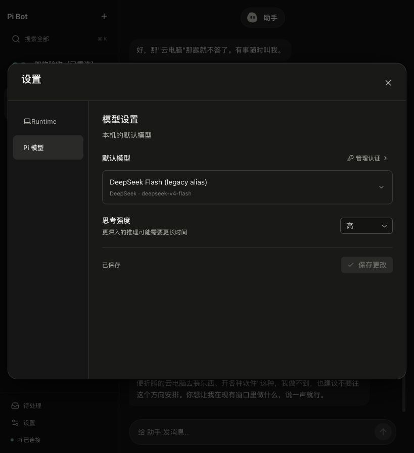
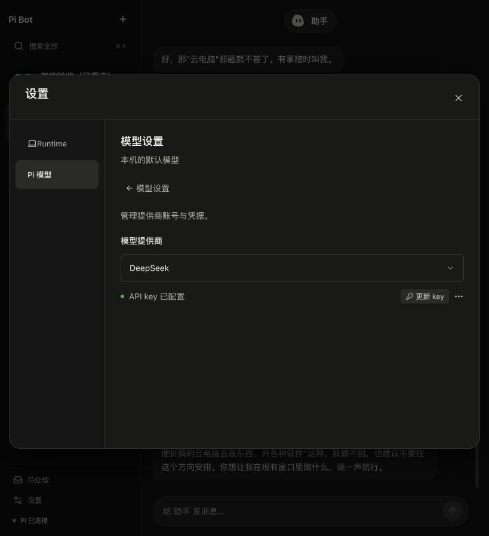
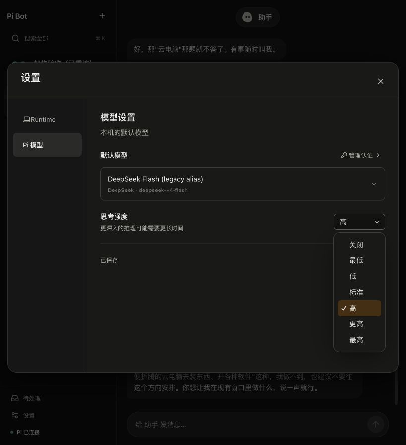
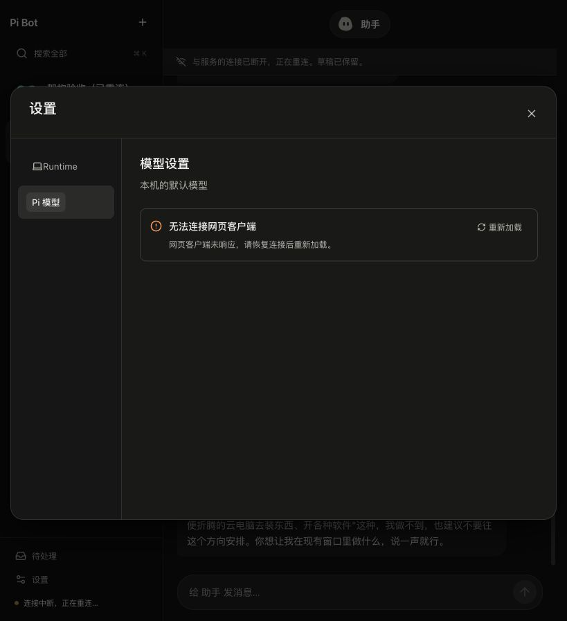

# 模型设置与二级认证页

2026-10-14。沿用 React、Radix Themes 和 cmdk；没有新增 UI 组件库。接续 [Runtime 连接指南](design/runtime-connections.md)。

主页面是模型的 **Use**：默认模型、思考强度、保存更改。**Auth** 在「管理认证」的二级页面，提供返回入口；不是并列页签。提供商登录、更新 key、退出登录都在该二级页面。未配置认证时，模型页保留连接提供商的入口。

模型选择器内置搜索，名称和提供商/模型 ID 分层显示，只列出已保存认证的提供商模型。认证页面浏览不同提供商，不会改变正在使用的模型；未保存的模型选择和思考强度在返回时保留。更新认证仍使用原生 Pi 私有输入通道，返回会取消未完成登录，凭据不会进入事件、聊天或截图。





## 下拉菜单高度修复

原全局规则把所有 `.radix-themes` 的高度设为 100%，也命中了 Radix portal 内的 Select Content，导致七个选项出现一大块空白。满屏高度现在仅属于 `.app-theme` 应用外壳；portal 不继承该约束。思考强度采用 Radix Popper 定位、内容高度和可用视口上限，普通窗口与 390×844 窄屏实际测得菜单均为 240px，没有越出视口。



## 断线提醒与恢复

本次复现时，原生 Pi server 正常，但 4317 的网页 client 已退出。原页面把网络异常直接展示为 `Failed to fetch`，并仍然展示空选择器。现在初次加载显示骨架；失败时显示操作范围内的提醒与重新加载入口。

- 浏览器到 client 无法连接，与隧道后 runtime 返回 502/503/504 分开提示。
- 保存或登录请求中断时，显示“操作结果尚未确认”，不自动重放写入。重新加载先读回状态。
- 410 表示连接已切换；400 等保留服务端的登录输入错误。
- 客户端恢复后，浏览器重新认证并读取当前 runtime 的模型配置。



## 验收

258 项离线测试通过，无跳过；类型检查、GUI lint/build 通过。新增两个真实 HTTP 故障测试，覆盖 socket 中断、写入不重放、410、502、400。21st 对修改的设置组件检查为零发现。

真实浏览器已验证：模型选择器搜索/键盘回车；关闭菜单后的焦点；保存按钮随未保存状态变化；在认证页浏览 Anthropic 不影响 Use 中的 DeepSeek；取消/返回未完成的登录；客户端真实停止与恢复；390px 窄屏和下拉菜单边界。认证值没有输入或修改，默认模型仍为 `deepseek-v4-flash`、thinking high。本次为设置与网络故障验收，没有新增模型 API benchmark。

复现：`npm run gui`，设置 → Pi 模型；点管理认证进入二级页面，返回后选择模型或思考强度。检查命令：

```sh
npm run check
npm run gui:check
node --import tsx --test test/pi-settings-client.test.ts
npm test
npm run gui:build
```
